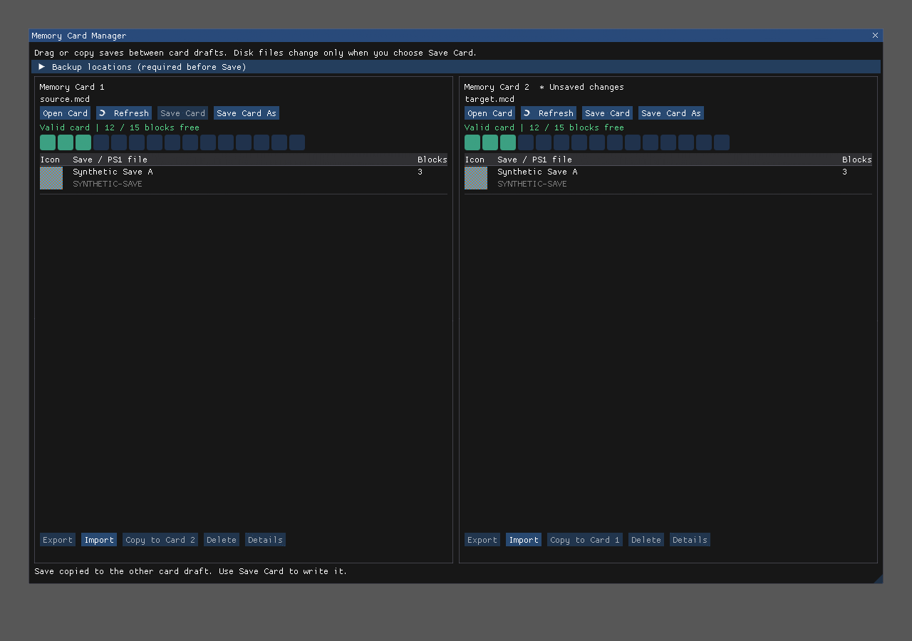

# Optional host-backed PS1 card editor

A PSX host may provide `RecompLauncherCGameInfo.card_manager` with ABI version 1.
A null/unsupported service adds no controls. Other console layouts are unchanged.
The service is available before boot only: the in-session launcher disables the
entry to prevent conflicting with a game's cached card state.

The UI provides two side-by-side cards, 15-block maps, animated icons, titles,
Open/Refresh/Save/Save As, MCS import/export, drag-copy and context-menu copy,
delete-from-draft, details, dirty indicators and Save/Discard/Keep Editing guards.
Windows Unicode card pickers run between presented frames. Narrow displays retain
two columns on a horizontal canvas. No parser, transaction, game-specific metadata
or personal configuration is duplicated in recomp-ui.



This illustration is software-rendered from actual headless ImGui draw data by
the committed test. All save content/icons are synthetic; it is not a desktop
capture or evidence of a new gameplay test. The user accepted the predecessor
Windows UI3 build; the shared-service refactor additionally has automated tests.

Backup folders can be chosen per session in the expandable section. The engine
refuses Save until its backup/storage policy is satisfied. UI API strings are
UTF-8, callbacks are synchronous and used only on the launcher thread. The host
owns two drafts and must catch exceptions at the C boundary. Borrowed views are
copied before another service call. Only confirmed Save/Save As crosses storage;
closing the window does not silently discard edits. Draft state is destroyed at
launcher teardown and recreated on the next launcher session.

## Maintainer decisions before leaving Draft

- Confirm the optional C service naming/ownership and append-only GameInfo field.
- Confirm the initial Windows/local-NTFS persistence scope and how persistent
  backup-location settings should eventually be represented. No POSIX writer is
  advertised without equivalent locking/flush/atomic-replacement validation.
- Choose merge order: shared contract/UI first, engine adapter second, title
  opt-in last; then update the official submodule pins. No fork pin is required.

## Tests

```sh
cmake -S tests/card_manager -B build-card-manager-tests
cmake --build build-card-manager-tests
ctest --test-dir build-card-manager-tests --output-on-failure
```

Windows tests run with an independent mock host and synthetic data. They exercise
real headless drag delivery, confirmation/cancellation, unsaved guards and 9 size/
scale combinations. The native dialog contract test checks Unicode/long paths,
flags, cancel and error handling without operating the desktop. A maintainer
should still test visible native dialogs and the title's card paths interactively.
No new all-region gameplay acceptance is claimed.

The new UI, protocol and tests use the repository's MIT licence. No third-party
card-editor source, game assets, personal cards or private build overlays are
included. An engine implementing the protocol retains its own licence.
